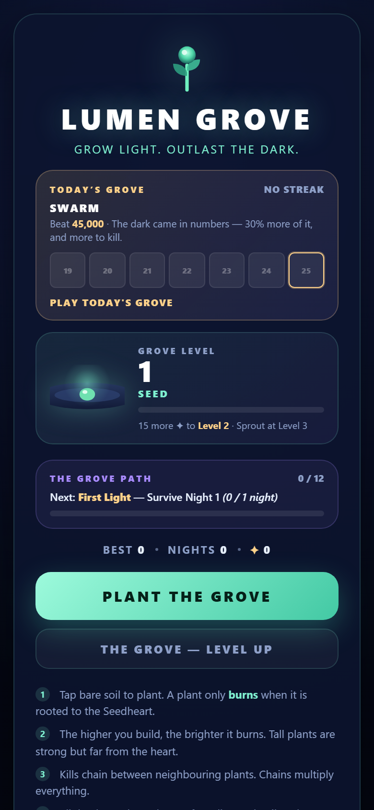
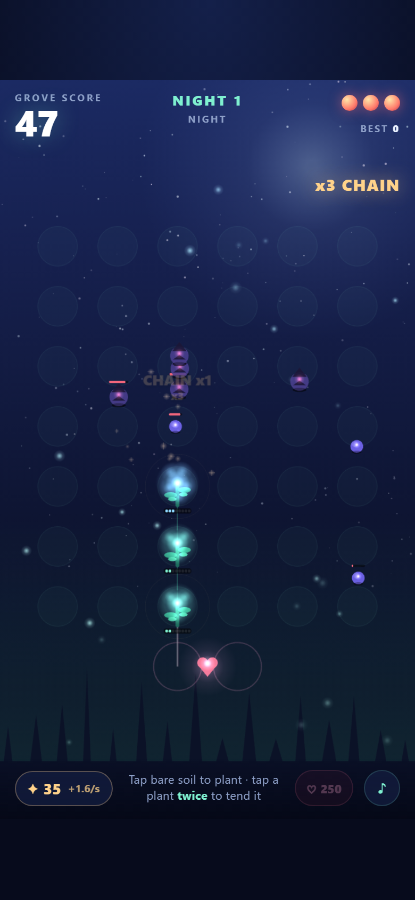
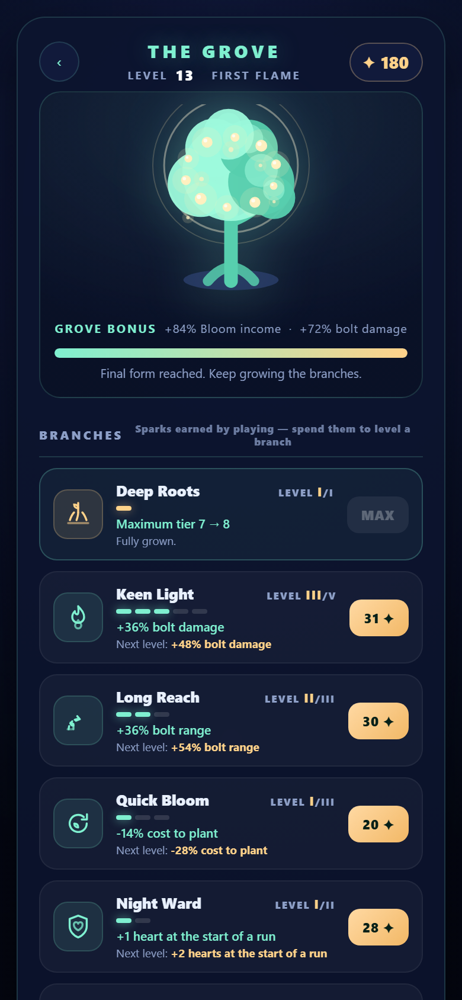
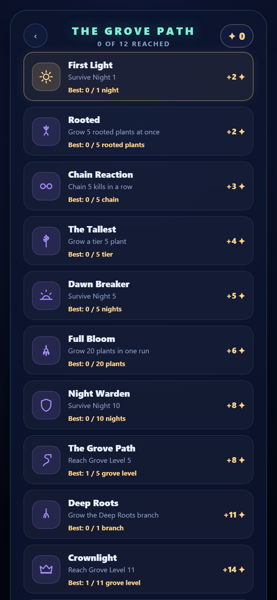

# Lumen Grove

**Grow light. Outlast the dark.**

A mobile arcade-defense hybrid for the browser — and the **balance harness** that
proves its difficulty curve is right.

> **Zero image assets. Zero audio assets. Zero network calls.** Every sprite is
> drawn procedurally, every sound is synthesised at runtime in WebAudio, and the
> whole game is **356 KB gzipped**.

**Play the free demo:** https://hy5uvm1q5ywq8.space.minimax.io
(installable on a phone — *Add to Home Screen*)

**Get the source licence:** **https://gumroad.com/l/lumen-grove**
— Personal $49 · Studio $149



---

## This repository is the open showcase

Everything that explains the work is public and free to read:

| Public here | |
| --- | --- |
| **`docs/DESIGN.md`** | The synthesis map — every mechanic, where it was borrowed from, and every measured balance number |
| **`docs/HARNESS.md`** | The methodology: how to measure a difficulty curve instead of guessing at one |
| **`docs/CUSTOMISING.md`** | How the game is put together, and how you would make it yours |
| **`preview/`** | The built, playable game — clone it and open `preview/index.html` |
| **`LICENSE.md`** | The source licence, in full |

What is **not** public is the source code and the harness itself — the complete
`src/` tree and the `tools/` rig are part of what you buy, because a licence
that can be cloned for free is not a licence.

That is not a trick, and it is not a water-marked demo. The live demo above is
the full game, running free, with no account and no limits.

---

## The thing most templates do not ship

Most game templates hand you a folder of code and a *"good luck"*. The part that
is actually hard to build is a **rig that measures your difficulty curve**, and
this one has it.

The simulation in `src/game/` imports nothing from Phaser, so the whole game can
be driven headlessly at thousands of times real speed. That is what lets the
project ship with a curve that is **measured, not asserted**:

```bash
npx tsx tools/simtest.ts              # 43 headless rule checks
npx tsx tools/balance.ts              # sweep every difficulty axis
npx tsx tools/balance.ts ladder 1     # how many runs to max the whole meta tree
npx tsx tools/balance.ts daily        # what a real run scores under each daily modifier
node  tools/playtest.mjs http://127.0.0.1:4173   # 43 checks in a real mobile Chromium
node  tools/manifest-check.mjs http://127.0.0.1:4173   # PWA installability audit
```

### The invariant the sweep enforces

**Careful play must clearly beat naive play.** If the table ever says otherwise,
your upgrade mechanic has stopped earning its keep — and the rig says so,
instead of you arguing about it in a forum.

This is real output from this project, not a mock-up:

```
  value | careful | no-tend | gappy | max careful | max gappy | sparks
  ------+---------+---------+-------+-------------+------------+--------
  1.27  | 11n      | 6n      | 5n    | 14n         | 7n         | 12
  1.35  | 9n       | 6n      | 5n    | 13n         | 7n         | 9
  1.42  | 8n       | 4n      | 4n    | 13n         | 6n         | 6
  1.49  | 7n       | 4n      | 4n    | 13n         | 5n         | 5
```

In this game a careful player holds **8 nights** while a never-promoting player
holds **4**. And the same rig answers the other question that quietly kills a
game — *is the meta progression over before the player is?* — by playing the
tree run after run, spending the currency the way a player would. Current
answer: **23 runs at one run a day** to max the Grove and every branch. A month
of daily play, not a weekend. An earlier build maxed the whole tree in **one**
run, and every player was finished by night three.

### Three bugs this rig caught that playtesting did not

1. **The enemy could never reach the defender.** A tier-7 plant puts out ~138
   dps against authored blight health of 4–48, so the blight died during its
   approach and never touched a single plant. The grove was a spectator for
   nine nights. `chewed=0` for nine straight nights was the tell.
2. **Wave size was doing the job of threat.** It only makes a night *longer*.
   Threat is the arrival *rate* against the time to kill one enemy — the
   backlog, not the count.
3. **Enemy health scaled to 100% of the player's power**, so a fully-invested
   grove hit **94 nights** instead of 13. Scaling to a *fraction* of the
   player's power makes progression buy a bounded number of extra nights
   instead of a runaway.

Full method: **[`docs/HARNESS.md`](docs/HARNESS.md)**.

---

## The game

A real-time lane defense on a 6×7 grid, wrapped in the instant-restart loop of
a hyper-casual score chaser, with the base-building brain of a strategy game
underneath.

1. **Tap bare soil to plant.** A plant only *burns* when it is **rooted** to
   the Seedheart — a continuous path of planted cells must connect it down to
   the heart at the bottom of the grid.
2. **Build upward.** Tier equals height above the heart, so a tall tower is
   strong but far from safety. The cheap tier-1 Saplings at the bottom are
   your wall.
3. **Tap a plant to tend it** — the first tap tells you what it will cost
   (`TEND → TIER 5 · 30 ✦`); a second tap commits it.
4. **Chains.** A kill ripples light into every rooted neighbour. Chains
   multiply your payout and fill the combo meter.
5. **Collect Light Motes** that drop from kills for permanent damage, fire
   rate and Bloom bonuses.
6. Three Blight reaching the Seedheart ends the run. **REGROW** restarts
   instantly.

### Two axes every other system hangs off

> **Is it rooted?** Connected to the Seedheart through a path of planted cells.
> Rooted plants fire and regenerate. Unrooted plants are dark, dead weight.
>
> **How high is it?** Tier equals height above the heart, plus any promotion you
> paid for.

That single tension is the design. Tall plants are strong but exposed. Front-line
plants are weak but they are the wall. Rooting forces commitment: a plant in
column 0 is only rooted if you paid for a path to reach it.



### Retention, built in

A score chase ends. Three interlocking systems give a reason to come back:

* **Today's Grove** — one shared grove and one shared target per calendar day,
  derived from the date. No server, no account, no network call. Plus a 7-day
  strip and a streak that survives until the end of the following day.
* **The Grove Path** — twelve one-time milestones, each paying Sparks, each
  illustrated, each showing how close the last run got.
* **The near miss** — the game-over screen *always* names the next milestone
  and how close you were: *"Night Warden — Survive Night 10. You reached 7 / 10
  nights."*
* **Deepen the Grove** — at Grove Level 11+ you can reset your level and
  branches for a permanent **Depth**.




---

## What's in the paid package

| | |
| --- | --- |
| `src/` | The whole game: simulation, renderer, DOM HUD, procedural SVG art, WebAudio synthesis |
| `tools/` | The balance and playtest harness — the reason to buy this |
| `docs/` | The design synthesis map, the harness method, and the customisation guide |
| `public/` | PWA manifest, service worker, app icons |
| A live, hosted demo | A URL you can send to buyers and reviewers |

The architecture rule that makes it all work:

> **The simulation owns the state. The renderer reads it.**
> `Run.drainEvents()` is the only channel from rules to effects.

---

## Licence

This project is **licensed, not sold**. You may ship it commercially, under
your own brand, monetised however you like.

* **Personal** — one product or title.
* **Studio** — unlimited products and titles, including shipping to a client or
  a publisher.

You may **not** redistribute the source, and a straight cosmetic copy of the
game is not your product: change something meaningful. Full terms:
**[`LICENSE.md`](LICENSE.md)**.

**Get the source licence, the live demo and the changelog:**
**https://gumroad.com/l/lumen-grove**

---

## Running the preview build

```bash
# any static server, from the repo root
npx serve preview
# then open http://localhost:3000
```

The preview is a production build of the game. It is served from a sub-path, so
it runs from GitHub Pages or any static host as-is.

---

*Original game by [xKryptic](https://github.com/zarasus37).*
